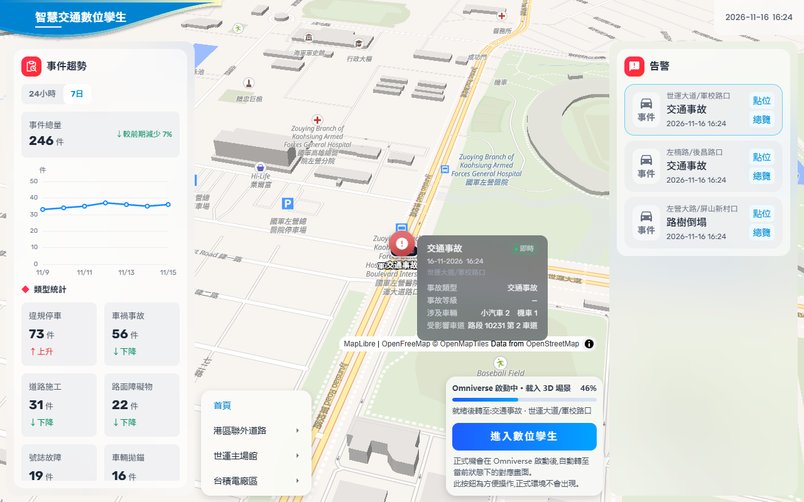

# 地圖首頁 — 開發參考包

智慧交通數位孿生(高雄世運周邊)的**地圖首頁**前端示例:進入 Omniverse 數位孿生之前，先以 2.5D 向量地圖呈現事件與號誌路口，並在 Omniverse 串流就緒後，自動轉至使用者當下在地圖上檢視的事件 / 路口 / 場域。

> **關於 Mapbox**:這頁最初以 Mapbox GL JS 開發,2026-11-04 改用 **MapLibre GL JS 6.15**(Mapbox GL v1 的開源分支,API 幾乎相同)。原因：不需要 access token、沒有用量計費、可完全離線。底圖用 OpenFreeMap 的免費向量圖磚(liberty 樣式，內建 3D 建物)。若要改回 Mapbox，見文末〈換回 Mapbox GL JS〉。



---

## 1. 包內容

| 目錄 | 內容 | 用途 |
|---|---|---|
| `minimal-example/` | 獨立的 Vite + React + TS 小專案(約 200 行),**不依賴**主專案任何元件 | 地圖核心手法，可直接搬到別的專案 |
| `screenshots/` | 主專案地圖首頁、最小範例的畫面 | |

主專案(智慧交通數位孿生前端)的原始碼**不在此 repo**——它是 NVIDIA web-viewer-sample 的衍生專案，帶 NVIDIA 授權。下文提到「主專案」的檔案路徑(如 `src/demo/MapPage.tsx`),需要時請向專案負責人索取。

## 2. 快速開始

需求:Node 18+、npm 10+、可用 WebGL 的瀏覽器。

### 最小範例

```bash
cd minimal-example
npm install
npm run dev          # http://localhost:5173
```

會看到世運周邊的 3D 地圖與 8 個點位，點標記會飛過去，「全部點位」回到總覽。


## 3. 主專案架構(參考)

```
App.tsx
 ├─ source === 'demo' 且尚未進入 → <MapPage onEnter={target => …}>     ← 本文件主角
 └─ 進入後 → <StreamPage initialFocusPrimPath={target}>                 (數位孿生)

MapPage.tsx
 ├─ 資料：demoScenes.ts 的 DEMO_ALERT_HOTSPOTS / DEMO_PLACE_HOTSPOTS
 │        (與數位孿生同一份 Kit hotspot,jsonData 帶 lat / long)
 │        └─ toGeo() → GeoPoint { id=primPath, kind, label, parentPath, lng, lat }
 ├─ 地圖:maplibre-gl Map(pitch 50°, bearing -15°)
 ├─ 標記:DOM 疊加層，用 map.project() 換算螢幕座標(沿用 POIPanel 的 .poi-marker 樣式)
 ├─ 左：EventTrendsPanel     右:AlertsPanel + EventOverviewModal
 ├─ 下:BottomControls(區域分區：場域 → 路口)
 ├─ 事件 popup:AlertPoiPopup(地圖像素 → 0–1 座標)
 └─ 右下：開機進度 + 「進入數位孿生」→ onEnter(handoff)
```

**設計原則：地圖頁不自帶資料、不自帶 UI。** 點位、告警、場域全部來自數位孿生同一份 hotspot,面板全部沿用 `src/ui/` 的元件，所以兩頁的告警數量、名稱、位置一定一致，主線改樣式這頁也跟著變。(早期這頁自帶一份 `mapPoints.ts`,結果兩頁告警數不同。)要改內容，改 `src/demo/demoScenes.ts`。

### 交接到數位孿生(handoff)

使用者在地圖上看什麼，數位孿生就停在什麼。優先序:

1. 開著的「事件概覽」彈窗的事件
2. 地圖上選中的事件 / 路口
3. 區域分區選的場域
4. 都沒有 → 首頁

交接值是 hotspot 的 `primPath`。`StreamPage` 收到 `initialFocusPrimPath` 後，等 Kit 就緒且 `hotspotUpdate` 帶到該 POI,才走與使用者點擊**相同**的路徑(事件 → `locateAlert`;場域 / 路口 → L2 + `focusPOI`)。在 Kit 就緒前送 `focusPOI` 會被丟掉，所以一定要等。

開機計時讀的是 `handoffRef`(而不是把 handoff 放進 effect 依賴),否則使用者每點一下地圖，計時就重來。

## 4. 核心手法與踩過的坑

以下每一點都對應 `minimal-example/src/MapView.tsx` 與主專案 `src/demo/MapPage.tsx` 裡的程式碼。

### 4.1 Worker 路徑(Vite)

```ts
import maplibreWorkerUrl from 'maplibre-gl/dist/maplibre-gl-worker.mjs?url';
setWorkerUrl(maplibreWorkerUrl);
```

MapLibre 6 預設用 `import.meta.url` 拼 worker 路徑，被 Vite 預打包進 `.vite/deps` 後該路徑不存在 → `Worker failed to load`。用 `?url` 讓 Vite 把 worker 當靜態資源發出,dev 與 build(含相對 base 的離線包)都正確。

**部署時**:worker 是 `.mjs`,以 module worker 載入，瀏覽器會嚴格檢查 MIME。伺服器必須回 `text/javascript`;回 `application/octet-stream` 地圖會整片空白(只在部署後才看得到,dev 正常)。nginx 預設 mime.types 若沒有 `.mjs`,請補上。

### 4.2 標記用 DOM 疊加，不用 `maplibregl.Marker`

```tsx
const project = () => {
    const next = {};
    POINTS.forEach((p) => { next[p.id] = map.project([p.lng, p.lat]); });
    setScreen(next);
};
map.on('move', project); map.on('resize', project); map.on('load', project);
```

- 標記元件(`.poi-marker`)自帶 `transform: translate(-50%,-50%)`,交給 Marker 會跟 Marker 的 transform 打架。
- 疊加層 `pointer-events: none`,標記本身 `auto`,地圖才能拖曳。
- 這樣可直接重用數位孿生的標記與 popup 元件(那邊也是用 0–1 螢幕座標疊在影像上)。
- 點位數十個以內每次 move 直接 setState 沒問題;**上千個點請改用 GeoJSON source + symbol/circle layer**,讓 GPU 畫。

### 4.3 相機

- 初始與「總覽」用 `fitBounds`,`padding` 左右各留 360px 給側欄、下方留給區域分區，否則點位會被面板蓋住。
- 單點用 `flyTo({ zoom: 16.8, pitch: 50, duration: 900 })`。
- 區域分區點場域時，框住 `parentPath` 屬於該場域的點;沒有座標的場域(港區、台積電)鏡頭不動。

### 4.4 錯誤處理(不能白畫面)

- `new Map()` 在 WebGL 不可用時(遠端桌面、舊顯卡)會直接 throw → catch 後顯示提示。
- 只有**樣式本身**載不到才算失敗(`style.load` 之前的 `error`);之後個別圖磚失敗不處理，地圖仍可用。
- 失敗時主專案以數位孿生底圖(`bg.png`)當背景，清單、面板與「進入」照常可用。
- 地圖容器失敗時也保持掛載——卸載它 map 實例會留在背景。

### 4.5 離線底圖

展示現場常沒有網路，所以展示包自帶世運周邊的圖磚。

```bash
node scripts/fetch-offline-map.mjs            # 下載到 offline-map/,已存在則跳過
node scripts/fetch-offline-map.mjs --refresh  # 重抓
```

| 項目 | 內容 |
|---|---|
| 樣式 | OpenFreeMap liberty,網址改寫為相對路徑 |
| 圖磚 | openmaptiles 向量圖磚 z0–14,範圍 `[120.20, 22.62, 120.40, 22.79]`(約 20 km 見方);z>14 由 MapLibre overzoom |
| 字型 | 只抓圖磚字串實際用到的 glyph 範圍。中日韓文字由 MapLibre 用系統字型在本機畫(`localIdeographFontFamily`),不需要 glyph 檔。全抓約 100 MB,這樣只要幾 MB |
| 鏡頭限制 | `style.metadata['offline:maxBounds']`(內圈 ~12 km)、`'offline:minZoom'`(12),MapPage 據此 `setMaxBounds` / `setMinZoom`,拖不出有圖磚的範圍 |
| 大小 | 約 24 MB |

使用方式：把 `offline-map/` 放到網站底下(展示包是 `app/map/`),設 `VITE_MAP_STYLE=map/style.json`。

**為什麼要 `resolveStyle()`**:MapLibre 不解析 style 內的相對網址。圖磚由 worker 抓，相對路徑會被當成相對 worker 檔(`assets/`)而 404。所以相對網址的樣式由前端先抓下來，把 `sprite` / `glyphs` / `sources.*.tiles|url` 補成以 `style.json` 所在目錄為基準的絕對網址。用**字串拼接**而不是 `new URL()`——URL 會把 `{z}`、`{fontstack}` 的大括號編碼掉。

要換範圍：改 `fetch-offline-map.mjs` 頂端的 `DOWNLOAD_BBOX` / `MAX_BOUNDS` / `MIN_ZOOM`。

## 5. 設定

`.env`(Vite 環境變數，主專案 `.env.example` 有同樣說明):

| 變數 | 預設 | 說明 |
|---|---|---|
| `VITE_MAP_STYLE` | `https://tiles.openfreemap.org/styles/liberty` | 任一 MapLibre style JSON 網址。相對網址 = 離線樣式(走 `resolveStyle`) |
| `VITE_DEMO_BOOT_SEC` | `30` | Omniverse 開機模擬秒數。`0` = 不自動轉場，只能按按鈕 |

## 6. 主專案檔案索引(不在此 repo)

| 檔案 | 說明 |
|---|---|
| `src/demo/MapPage.tsx` | **地圖首頁本體**。檔頭註解記錄了所有設計決策 |
| `src/demo/MapPage.css` | 只有地圖頁特有的樣式;面板、標記樣式來自 `src/ui/` |
| `src/demo/demoScenes.ts` | 點位資料(hotspot)。`DEMO_INTERSECTIONS` 是號誌路口座標(取自 VISSIM 資料集) |
| `scripts/fetch-offline-map.mjs` | 離線圖磚下載。內含一個極簡 MVT(protobuf)解析器，用來算實際用到的字元 |
| `scripts/pack-demo.mjs` | 打離線展示包，會自動呼叫上面的腳本並把圖磚放進 `app/map/` |
| `src/App.tsx` | 掛載 MapPage 與交接(搜尋 `mapEntered` / `mapHandoff`) |
| `src/pages/StreamPage.tsx` | 接收交接(搜尋 `initialFocusPrimPath`) |
| `src/ui/POIPanel.tsx` / `.css` | 標記樣式 `.poi-marker`(地圖頁沿用) |
| `src/ui/AlertsPanel.tsx`、`AlertPoiPopup.tsx`、`EventOverviewModal.tsx`、`BottomControls.tsx`、`EventTrendsPanel.tsx` | 沿用的面板 |
| `deploy/server.ps1` | 離線展示包的靜態伺服器,MIME 表有 `.mjs` 的註解 |
| `CHANGELOG.md` | 2026-11-04 起的地圖相關條目有完整的問題與修法 |
| `CLAUDE.md` | 整個專案的架構說明(圖層、Kit 訊息協定、demo 模式) |

## 7. 接正式資料時

- 正式環境的點位來自 Kit 的 `hotspotUpdate`(由 `useKitMessages` 處理),每筆是 `{ primPath, x, y, visible, jsonData, parent }`,`jsonData` 是 **JSON 字串**,要防禦性解析(壞的跳過，不要 throw)。地圖只需要 `jsonData.lat` / `jsonData.long`。
- 但地圖頁出現在 Kit 就緒**之前**,所以正式版需要另一個來源提供點位(例如後端 API 或靜態 JSON),欄位建議沿用 hotspot 的形狀與 `primPath` 當 id,交接才對得上。
- 告警 identity 用 `alertGroupId(code, primPath)`(`src/ui/alertAnimation.ts`),它會把路段封閉的 `_start` / `_end` 兩端合成一筆。
- 「進入數位孿生」按鈕與進度條是展示用;正式環境應由串流真正就緒的事件觸發 `onEnter(handoff)`。

## 8. 換回 Mapbox GL JS

API 幾乎相同，主要差異:

```ts
import mapboxgl from 'mapbox-gl';
import 'mapbox-gl/dist/mapbox-gl.css';
mapboxgl.accessToken = import.meta.env.VITE_MAPBOX_TOKEN;
const map = new mapboxgl.Map({ container, style: 'mapbox://styles/mapbox/light-v11', center, zoom, pitch, bearing });
```

- 需要 access token,依載入次數計費;token 會出現在前端，請在 Mapbox 後台限制網域。
- 不需要 `setWorkerUrl`(mapbox-gl 的 worker 隨套件內建)。
- Mapbox 服務條款一般不允許像 `fetch-offline-map.mjs` 那樣自行批次下載快取圖磚;有離線需求建議維持 MapLibre + 開放圖資。
- CSS 類名前綴由 `maplibregl-` 變成 `mapboxgl-`(主專案 `MapPage.css` 移動版權標示的那條規則要改)。

## 9. 授權

- 地圖右下角的 © OpenStreetMap / OpenFreeMap / OpenMapTiles 標示**必須看得到**(主專案把它移到右側欄左邊，避免被面板蓋住)。
- MapLibre GL JS:BSD-3-Clause。
- 本 repo 的 `minimal-example/` 為獨立撰寫的範例，不含 NVIDIA 授權程式碼。
